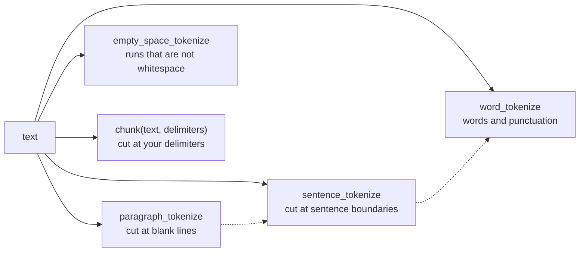

# Getting started

<!-- agent-hint
covers: install quebra_frases and split one text into words, sentences, paragraphs and chunks
source: quebra_frases/tokenization.py, quebra_frases/chunks.py, quebra_frases/tokens.py, pyproject.toml
generated: no
verify: python -m doctest -o NORMALIZE_WHITESPACE docs/getting-started.md
see: docs/words.md, docs/sentences.md, docs/chunks.md
-->

This page installs quebra_frases and walks through each kind of split once. Each step shows the real output of the code.

## Step 1: Install the package

quebra_frases needs Python 3.11 or later. Its only dependency is `regex`.

```bash
pip install --pre quebra_frases
```

The `--pre` flag installs the latest alpha release. Omit it to install the latest stable release.

## Step 2: Split a text into words

`word_tokenize` returns the words and the punctuation as separate tokens. A number keeps its decimal comma, and a time keeps its colon.

```python
>>> from quebra_frases import word_tokenize
>>> word_tokenize("O Pedro pagou 2,50 € às 14:30. Ótimo!")
['O', 'Pedro', 'pagou', '2,50', '€', 'às', '14:30', '.', 'Ótimo', '!']

```

To get the position of each token in the text, use `span_indexed_word_tokenize`. Each tuple holds the start offset, the end offset and the token.

```python
>>> from quebra_frases import span_indexed_word_tokenize
>>> span_indexed_word_tokenize("Olá, mundo!")
[(0, 3, 'Olá'), (3, 4, ','), (5, 10, 'mundo'), (10, 11, '!')]

```

## Step 3: Split a text into sentences

`sentence_tokenize` does not split after an abbreviation such as "Mr." or inside a number such as "1.5".

```python
>>> from quebra_frases import sentence_tokenize
>>> sentence_tokenize("Mr. Smith bought cheapsite.com for 1.5 million dollars. Did he mind?")
['Mr. Smith bought cheapsite.com for 1.5 million dollars.', 'Did he mind?']

```

[How a sentence boundary is decided](sentence-boundaries.md) gives every rule.

## Step 4: Split a text into paragraphs

`paragraph_tokenize` splits at blank lines. The blank lines stay at the end of the paragraph before them.

```python
>>> from quebra_frases import paragraph_tokenize
>>> paragraph_tokenize("First paragraph.\nStill first.\n\nSecond paragraph.")
['First paragraph.\nStill first.\n\n', 'Second paragraph.']

```

## Step 5: Cut a text at keywords

`chunk` cuts a text at each keyword you give it. The keywords stay in the result as chunks of their own.

```python
>>> from quebra_frases import chunk
>>> chunk("turn on the light and the fan", ["light", "fan"])
['turn on the', 'light', 'and the', 'fan']

```

## Step 6: Compare sample sentences

`get_common_chunks` returns the word runs that every sample shares. `get_exclusive_chunks` returns the word runs that only one sample has. Both return a set, so the examples sort the result.

```python
>>> from quebra_frases import get_common_chunks, get_exclusive_chunks
>>> samples = ["tell me what do you dream about",
...            "tell me what did you dream about",
...            "tell me what are your dreams about"]
>>> sorted(get_common_chunks(samples))
['about', 'tell me what']
>>> sorted(get_exclusive_chunks(samples))
['are your dreams', 'did', 'do']

```

## Which split to use

The functions form families. Each family has a plain form, a form with `char_indexed_` in front that returns `(start, text)`, and a form with `span_indexed_` in front that returns `(start, end, text)`.



*Figure: one text enters each family on its own. The dotted arrows show a way to combine them: split a paragraph into sentences, and a sentence into words.*

## Next steps

Each family of functions has its own page. Start with [Words](words.md), or go to the [API reference](api.md) for the full list of names.

---

[Index](index.md) · Previous: [Index](index.md) · Next: [Words](words.md)
